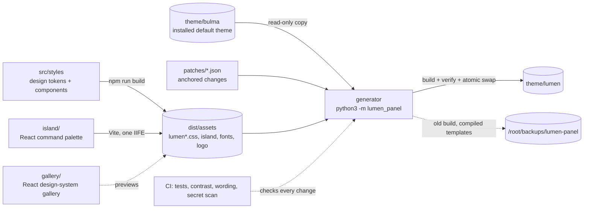

<!-- header:begin: brand-repos 0.1.0, variant studio, files in docs/brand/; the project-page sync drops this block -->
<picture>
  <source media="(prefers-color-scheme: dark)" srcset="docs/brand/readme-header-dark.svg">
  <source media="(prefers-color-scheme: light)" srcset="docs/brand/readme-header-light.svg">
  
</picture>

<!-- byline:studio -->
*a [Luminare Development](https://luminare.tech/open-source/lumen-panel/) open-source project*
<!-- /byline:studio -->
<!-- byline:personal
*by Paul Pasaurek · [project page](https://luminare.tech/open-source/lumen-panel/)*
/byline:personal -->
<!-- header:end -->

# lumen-panel

A modern theme for the KeyHelp hosting panel: a calm, accessible design in light and dark mode,
a Ctrl+K command palette, and a generator that builds the theme on the server from the panel's
own default theme.

[](https://github.com/luminare-dev/lumen-panel/actions/workflows/ci.yml)
[](https://github.com/luminare-dev/lumen-panel/releases)
[](LICENSE)
[](https://scorecard.dev/viewer/?uri=github.com/luminare-dev/lumen-panel)

## Why

The panel's default theme works, but its type, greys and states are dated, several grey text
colours fall below the WCAG AA contrast minimum, and the panel has no quick way to jump between
its many pages. A theme can fix that, but a theme folder is a full copy of the default templates:
those belong to Keyweb AG, cannot be published, and go stale with every panel update.
lumen-panel publishes only its own work (design tokens, stylesheets, a React command palette, a
React design-system gallery) and a generator that patches a local copy of the default templates
in a few anchored places, verifies the result and swaps it in atomically, with a backup and a
one-command rollback.

## Quickstart

```bash
git clone https://github.com/luminare-dev/lumen-panel.git && cd lumen-panel
npm ci && npm run build
cd generator && sudo python3 -m lumen_panel install --keyhelp /home/keyhelp/www/keyhelp --dry-run
sudo python3 -m lumen_panel install --keyhelp /home/keyhelp/www/keyhelp
```

Then select **Lumen** under Configuration -> Theme. Details, requirements and uninstalling:
[docs/install.md](docs/install.md).

## How it works



- **Stylesheet.** `--lm-*` design tokens from the Luminare brand palette, Sora for type, an 8px
  spacing grid, 10-14px radii, hairline borders instead of heavy shadows, visible focus rings.
  Dark mode follows the panel's own per-user switch; right-to-left pages use the default theme's
  RTL build plus logical properties; reduced motion is respected.
- **Patch set.** Seven small patches load the stylesheet and the palette script and show the
  Luminare logo on the login page and in the header. Each anchor must occur exactly once, or
  nothing is installed.
- **Command palette.** Ctrl+K (Cmd+K) on every page after login: searches the panel's own
  navigation, keyboard and screen-reader accessible, rendered in a shadow root, no network
  requests, nothing stored.
- **Gallery.** `npm run dev` shows every component in light, dark, LTR and RTL without a panel.

## Design decisions

The decisions behind this project are recorded as short ADRs in [docs/adr/](docs/adr/):

- [ADR 0001: Record architecture decisions](docs/adr/0001-record-architecture-decisions.md)
- [ADR 0002: Pin every action and downloaded tool](docs/adr/0002-pin-actions-and-downloaded-tools.md)
- [ADR 0003: Secret scanning with the gitleaks binary](docs/adr/0003-secret-scanning-with-the-gitleaks-binary.md)
- [ADR 0004: Draft releases with checksums and provenance](docs/adr/0004-draft-releases-with-checksums-and-provenance.md)
- [ADR 0005: Build the theme on the server from the installed default theme](docs/adr/0005-build-the-theme-on-the-server.md)
- [ADR 0006: Small anchored patches that fail loudly](docs/adr/0006-anchored-patches-that-fail-loudly.md)
- [ADR 0007: React for the gallery and one island, not for the panel](docs/adr/0007-react-for-the-gallery-and-one-island.md)
- [ADR 0008: Override by matching selectors, not with cascade layers](docs/adr/0008-override-by-selector-not-by-layer.md)
- [ADR 0009: Atomic swap, backups instead of deletes, narrow cache purge](docs/adr/0009-atomic-swap-backups-and-narrow-cache-purge.md)

**Alternatives.** The panel's white-label settings change the logo, the favicon and add custom
CSS; that is the right tool for a logo and a few colours, and Lumen keeps it working on top. A
hand-maintained copy of the default theme gives full control over the markup, but it cannot be
shared and drifts with every panel update.

## Supported versions

| Component | Tested with | Supported |
|---|---|---|
| KeyHelp (default theme `bulma`) | 26.1.1 (build and verify) | 26.1.x; other versions when every patch anchor still fits (the build checks) |
| Python (generator) | 3.12 | 3.10 or later |
| Node.js (asset build) | not run yet | 22.12 or later |
| Browsers | not yet tested in a browser | written for Chrome/Edge 111+, Firefox 121+, Safari 16.4+ |

Fixes go into the latest minor release only. See the
[security policy](https://github.com/luminare-dev/.github/blob/main/SECURITY.md) for reporting.

## Limitations

- Only the default theme's markup is restyled; pages a panel update adds look right only as far
  as they use the same Bulma components.
- After a panel update, `sync` must run (manually or from a timer) before the copied templates
  match the panel again; until then, the previous build stays active.
- The Luminare logo replaces the KeyHelp logo on every panel page, also for client accounts.
- No release ships prebuilt assets yet: the server, or another machine, needs Node.js once per
  release to run `npm run build`.
- The command palette knows only the links of the sidebar and the user menu, not the actions
  inside pages.
- Arabic and Hebrew text falls back to the system font; Sora has no glyphs for these scripts.

## Results

| What | Value | How it was measured |
|---|---|---|
| Contrast, text pairs | 42 pairs, lowest 4.55:1 (light) and 5.15:1 (dark), minimum 4.5:1 | `python3 scripts/contrast.py`, WCAG 2.x formula, 2026-10-21; full table in [docs/contrast.md](docs/contrast.md) |
| Contrast, UI parts | 11 pairs (control borders, focus rings, progress fills), lowest 3.43:1 (light) and 3.16:1 (dark), minimum 3:1 | same |
| Tests | see CI | `python3 -m unittest discover -s tests -v` and `npm test` |

## Documentation and links

- [Installation](docs/install.md) · [Configuration](docs/configuration.md) ·
  [Upgrade](docs/upgrade.md) · [Troubleshooting](docs/troubleshooting.md) ·
  [Runbook](docs/runbook.md) · [ADRs](docs/adr/) · [Panel markup inventory](docs/keyhelp-markup.md) ·
  [Contrast table](docs/contrast.md)
- [Changelog](CHANGELOG.md) and [releases](https://github.com/luminare-dev/lumen-panel/releases)
  (each release has `SHA256SUMS` and a build provenance attestation)
- [Contributing](https://github.com/luminare-dev/.github/blob/main/CONTRIBUTING.md) ·
  [Code of conduct](https://github.com/luminare-dev/.github/blob/main/CODE_OF_CONDUCT.md) ·
  [Security](https://github.com/luminare-dev/.github/blob/main/SECURITY.md) ·
  [Support](https://github.com/luminare-dev/.github/blob/main/SUPPORT.md)
- Project page: <https://luminare.tech/open-source/lumen-panel/>

## Not affiliated

Not affiliated with or endorsed by Keyweb AG. KeyHelp is a registered trademark of Keyweb AG and
is named only to describe what this project works with. This repository contains no KeyHelp file;
the theme is built from the KeyHelp installation on the server where it runs.

## Licence

[MIT](LICENSE). The licence covers the code only: the project name, logo, header images,
`docs/brand/` and `assets/brand/` are not licensed (see [NOTICE](NOTICE)). The Sora font keeps its
own licence ([THIRD_PARTY_NOTICES.md](THIRD_PARTY_NOTICES.md)).

<!-- byline:studio -->
*a [Luminare Development](https://luminare.tech/open-source/lumen-panel/) open-source project*
<!-- /byline:studio -->
<!-- byline:personal
*by Paul Pasaurek · [project page](https://luminare.tech/open-source/lumen-panel/)*
/byline:personal -->
