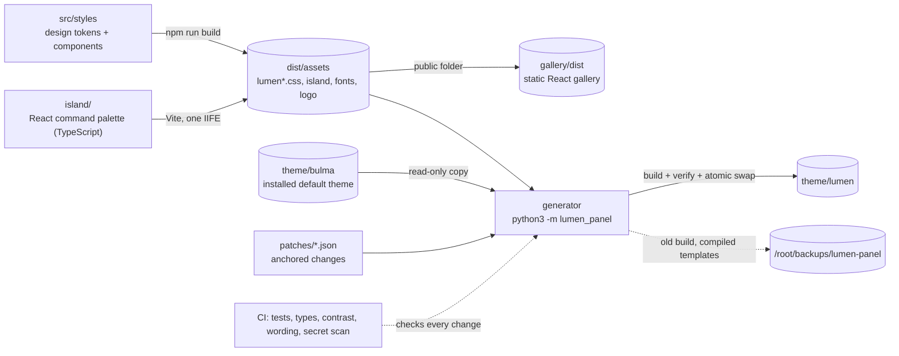

<!-- header:begin: brand-repos 0.1.0, variant studio, files in docs/brand/; the project-page sync drops this block -->
<picture>
  <source media="(prefers-color-scheme: dark)" srcset="docs/brand/readme-header-dark.svg">
  <source media="(prefers-color-scheme: light)" srcset="docs/brand/readme-header-light.svg">
  
</picture>

<!-- byline:studio -->
*a [Luminare Development](https://luminare.tech/open-source/lumen-panel/) open-source project*
<!-- /byline:studio -->
<!-- byline:personal
*by Paul Pasaurek · [project page](https://luminare.tech/open-source/lumen-panel/)*
/byline:personal -->
<!-- header:end -->

# lumen-panel

A modern theme for the KeyHelp hosting panel: a calm, accessible design in light and dark mode, a
React command palette (Ctrl+K) and a generator that builds the theme on the server from the
panel's own default theme. Tested with KeyHelp 26.1.1.

[](https://github.com/luminare-dev/lumen-panel/actions/workflows/ci.yml)
[](https://github.com/luminare-dev/lumen-panel/releases)
[](LICENSE)
[](https://scorecard.dev/viewer/?uri=github.com/luminare-dev/lumen-panel)

## Screenshot

<!-- Screenshot slot: docs/images/lumen-light.png and docs/images/lumen-dark.png (1280x800),
     taken from the gallery with example data only, shown in a <picture> like the header above. -->
There is no screenshot in the repository yet. The [gallery](#gallery) renders every page and
component in light and dark mode, left to right and right to left.

## Why

The panel's default theme follows Bulma 0.9 defaults; two of its grey text helpers (#7a7a7a at
4.29:1 and #b5b5b5 at 2.05:1 on white) fall below the WCAG AA minimum of 4.5:1, and the panel has
no quick way to jump between its many pages. A theme can fix that, but a theme folder is a full copy of the default templates:
those belong to Keyweb AG, cannot be published, and go stale with every panel update.
lumen-panel publishes only its own work (design tokens, stylesheets, a React command palette, a
React design-system gallery) and a generator that patches a local copy of the default templates
in a few anchored places, verifies the result and swaps it in atomically, with a backup and a
one-command rollback.

## Quickstart

On the panel server, as root:

```bash
git clone https://github.com/luminare-dev/lumen-panel.git /opt/lumen-panel
# put a built dist/assets/ into /opt/lumen-panel/: build it on another machine and copy it, or
# build here with the memory-limited commands in docs/install.md (never npm without a limit
# on a small server)
cd /opt/lumen-panel/generator
python3 -m lumen_panel install --keyhelp /home/keyhelp/www/keyhelp --dry-run
python3 -m lumen_panel install --keyhelp /home/keyhelp/www/keyhelp
```

Then select **Lumen** under Configuration -> Theme ([docs/install.md](docs/install.md#install)).

After a KeyHelp update, rebuild when needed (or let the optional units in `contrib/` do it, on
every panel update and once a day, [docs/update.md](docs/update.md)):

```bash
python3 -m lumen_panel sync --keyhelp /home/keyhelp/www/keyhelp
```

Undo the last install, or remove the theme (select the default theme in the panel first):

```bash
python3 -m lumen_panel rollback --keyhelp /home/keyhelp/www/keyhelp --from /root/backups/lumen-panel/<timestamp>
python3 -m lumen_panel uninstall --keyhelp /home/keyhelp/www/keyhelp --panel-url https://<your panel>/
```

Every install prints its rollback command and saves it as `ROLLBACK.txt` in the backup folder. A
rollback holds the theme: `sync` does not rebuild until the next `install` (or `release`).

## How it works



### The generator, and why KeyHelp's files are not in this repository

A KeyHelp theme is a folder with a complete set of Twig templates. The default theme's templates,
stylesheets, scripts and images are Keyweb AG's proprietary files, licensed with each panel; they
may not be published, and a published copy would also be out of date after the next panel
update. So this repository contains none of them. The generator (`python3 -m lumen_panel`,
Python standard library only) assembles the theme on the server where the panel is installed:

1. It reads `theme/bulma` of the local installation (never changing it) and copies its templates
   byte for byte into a staging folder; if a panel update changes them meanwhile, it stops.
2. It applies the seven patches in `patches/*.json`. Each one inserts a few lines of our own
   markup next to an anchor that must occur exactly once (load the Lumen stylesheet, load the
   palette script on internal pages, show the Luminare logo). If an anchor is missing or
   repeated, nothing is written and every failing patch is listed.
3. It adds Lumen's own files from `dist/assets/`, writes `_settings.json` and a build record
   (default theme version, the hash of every template, the patches, the asset and patch-set
   hashes), and verifies the result: every template must equal the default theme's file, or the
   default theme's file with the patches applied, byte for byte.
4. `install` swaps the staging folder in at `theme/lumen` with one atomic rename; the previous
   build and its compiled Twig templates move to `/root/backups/lumen-panel/<timestamp>/`.
   Nothing is deleted. One run at a time (a lock), and a run that is stopped halfway leaves
   nothing the panel would list as a theme; the next run moves its folders to the backups.

The patched templates keep loading the default theme's own CSS, JavaScript and images from
`/theme/bulma/`, which KeyHelp updates in place. `check-update` and `sync` compare the build
record with the installed default theme, the built assets and the patch set, and rebuild when
one of them changed.

### What you get

- **Stylesheet.** `--lm-*` design tokens from the Luminare brand palette, Sora for type, an 8px
  spacing grid, 10-14px radii, hairline borders instead of heavy shadows, visible focus rings.
  Dark mode follows the panel's own per-user switch; right-to-left pages use the default theme's
  RTL build plus logical properties; reduced motion is respected. Every design-token pair in
  [docs/contrast.md](docs/contrast.md) meets WCAG 2.2 AA in light and dark mode (67 pairs,
  including the default theme's checkboxes, Select2 options, status text on striped and hovered
  rows, close buttons and footnote marks, which Lumen overrides). The table covers the colours
  Lumen sets, not rules of the default theme it leaves alone.
- **Command palette.** Ctrl+K (Cmd+K on a Mac), or the search button in the header, on every
  page after login. It lists the panel's own sidebar and user-menu links, searches them while
  ignoring case and accents, and works fully with the keyboard and a screen reader (modal dialog,
  combobox with a listbox, focus trap, focus returns on close). It renders in shadow roots, so
  its styles and the panel's cannot touch each other, makes no network requests and stores
  nothing ([ADR 0010](docs/adr/0010-the-command-palette-stores-nothing.md)). One deferred script,
  React included, at most 80 KB after gzip (checked by the build; about 72 KB today).
- **Gallery.** A static React app with our own panel-like markup on Bulma 0.9.4: design tokens
  with live contrast numbers, typography, the app shell, cards, tables, pagination, forms,
  buttons, tags, notifications, modals, tabs, the dashboard and the login page, each in light,
  dark, LTR and RTL.

### Gallery

Run it locally (Node.js 22.22.2 or later; no panel needed):

```bash
npm ci --ignore-scripts
npm run dev                         # builds the CSS and the palette, then serves http://localhost:5173/
npm run build && npm run preview    # the static build in gallery/dist/
```

`gallery/dist/` uses relative paths, so it can be served from any folder of any static web
server. The start state can be set in the address, for example `?mode=dark&dir=rtl#forms`. CI
keeps every build of it as the `gallery` artifact for 14 days.

## Design decisions

The decisions behind this project are recorded as short ADRs in [docs/adr/](docs/adr/):

- [ADR 0001: Record architecture decisions](docs/adr/0001-record-architecture-decisions.md)
- [ADR 0002: Pin every action and downloaded tool](docs/adr/0002-pin-actions-and-downloaded-tools.md)
- [ADR 0003: Secret scanning with the gitleaks binary](docs/adr/0003-secret-scanning-with-the-gitleaks-binary.md)
- [ADR 0004: Draft releases with checksums and provenance](docs/adr/0004-draft-releases-with-checksums-and-provenance.md)
- [ADR 0005: Build the theme on the server from the installed default theme](docs/adr/0005-build-the-theme-on-the-server.md)
- [ADR 0006: Small anchored patches that fail loudly](docs/adr/0006-anchored-patches-that-fail-loudly.md)
- [ADR 0007: React for the gallery and one island, not for the panel](docs/adr/0007-react-for-the-gallery-and-one-island.md)
- [ADR 0008: Override by matching selectors, not with cascade layers](docs/adr/0008-override-by-selector-not-by-layer.md)
- [ADR 0009: Atomic swap, backups instead of deletes, narrow cache purge](docs/adr/0009-atomic-swap-backups-and-narrow-cache-purge.md)
- [ADR 0010: The command palette stores nothing, not even a "recent" list](docs/adr/0010-the-command-palette-stores-nothing.md)

**Alternatives.** The panel's white-label settings change the logo, the favicon and add custom
CSS; that is the right tool for a logo and a few colours, and Lumen keeps it working on top. A
hand-maintained copy of the default theme gives full control over the markup, but it cannot be
shared and drifts with every panel update.

## Supported versions

| Component | Tested with | Supported |
|---|---|---|
| KeyHelp (default theme `bulma`) | 26.1.1 (generator build and verify on the live install, read-only) | 26.1.x; other versions when every patch anchor still fits (the build checks) |
| Python (generator) | 3.12 | 3.10 or later |
| Node.js (asset build, tests) | not run yet | 22.22.2 or later (22.x), 24.15 or later, 26 |
| Browsers | not yet tested in a browser | written for Chrome/Edge 111+, Firefox 121+, Safari 16.4+ |

Fixes go into the latest minor release only. See the
[security policy](https://github.com/luminare-dev/.github/blob/main/SECURITY.md) for reporting.

## Limitations

- Only the default theme's markup is restyled; pages a panel update adds look right only as far
  as they use the same Bulma components.
- After a panel update, `sync` must run (manually or from the units) before the copied templates
  match the panel again; until then, the previous build stays active. When a patch no longer fits,
  that previous build keeps running against the new panel until the patch set is fixed
  ([runbook](docs/runbook.md#failure-lumen-panel-syncservice-failed)).
- The Luminare logo replaces the KeyHelp logo on every panel page, also for client accounts.
- No release ships prebuilt assets yet: the server, or another machine, needs Node.js once per
  release to run `npm run build`.
- The command palette knows only the links of the sidebar and the user menu, not the actions
  inside pages, and it has no "recent pages" list.
- Sora covers Latin only: in the Russian, Arabic and Chinese panels the whole page uses the
  system font instead.
- Chart.js charts and the code and text editors (CodeMirror, Trumbowyg) keep the default theme's
  colours ([docs/keyhelp-markup.md](docs/keyhelp-markup.md)).

## Results

| What | Value | How it was measured |
|---|---|---|
| Contrast, text pairs | 51 pairs, lowest 4.55:1 (light) and 4.51:1 (dark), minimum 4.5:1 | `python3 scripts/contrast.py`, WCAG 2.x formula, 2026-10-21; full table in [docs/contrast.md](docs/contrast.md) |
| Contrast, UI parts | 16 pairs (control borders, focus rings, progress fills, close-button crosses), lowest 3.17:1 (light) and 3.08:1 (dark), minimum 3:1 | same |
| Generator and repository tests | 172 Python tests pass, 4 skipped (gitleaks and markdownlint-cli2 not installed, one template-only test) | `LUMEN_BRAND_KIT=<kit> python3 -m unittest discover -s tests`, 2026-10-21, with the KeyHelp 26.1.1 install present (read-only) |
| Generator against the live panel | build and verify pass: 215 templates, 211 byte for byte equal to the default theme, 4 patched files reproduce exactly; dry run passes | `python3 -m lumen_panel build` and `verify --keyhelp` into a scratch folder with placeholder assets, KeyHelp 26.1.1, read-only, 2026-10-21 |
| Command palette tests | not run yet (Vitest suite of 41 tests in `island/test/`) | `npm test` |
| Command palette size | 71.7 KB after gzip (CI, 2026-10-21); the build fails above 80 KB | `node scripts/check-island.mjs` |

## Documentation and links

- [Installation](docs/install.md) · [Keeping it current after KeyHelp updates](docs/update.md) ·
  [Configuration](docs/configuration.md) · [Upgrading lumen-panel](docs/upgrade.md) ·
  [Troubleshooting](docs/troubleshooting.md) · [Runbook](docs/runbook.md) · [ADRs](docs/adr/) ·
  [Panel markup inventory](docs/keyhelp-markup.md) · [Contrast table](docs/contrast.md)
- [Changelog](CHANGELOG.md) (written by release-please) and
  [releases](https://github.com/luminare-dev/lumen-panel/releases) (each release has
  `SHA256SUMS` and a build provenance attestation)
- [Contributing](https://github.com/luminare-dev/.github/blob/main/CONTRIBUTING.md) ·
  [Code of conduct](https://github.com/luminare-dev/.github/blob/main/CODE_OF_CONDUCT.md) ·
  [Security](https://github.com/luminare-dev/.github/blob/main/SECURITY.md) ·
  [Support](https://github.com/luminare-dev/.github/blob/main/SUPPORT.md)
- Project page: <https://luminare.tech/open-source/lumen-panel/>

## Not affiliated

Not affiliated with or endorsed by Keyweb AG. KeyHelp is a registered trademark of Keyweb AG and
is named only to describe what this project works with. This repository contains no KeyHelp file;
the theme is built from the KeyHelp installation on the server where it runs.

## Licence

[MIT](LICENSE). The licence covers the code only: the project name, logo, header images,
`docs/brand/` and `assets/brand/` are not licensed (see [NOTICE](NOTICE)). The Sora font keeps its
own licence ([THIRD_PARTY_NOTICES.md](THIRD_PARTY_NOTICES.md)).

<!-- byline:studio -->
*a [Luminare Development](https://luminare.tech/open-source/lumen-panel/) open-source project*
<!-- /byline:studio -->
<!-- byline:personal
*by Paul Pasaurek · [project page](https://luminare.tech/open-source/lumen-panel/)*
/byline:personal -->
