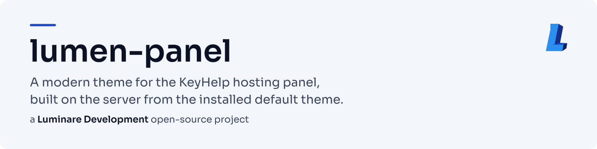
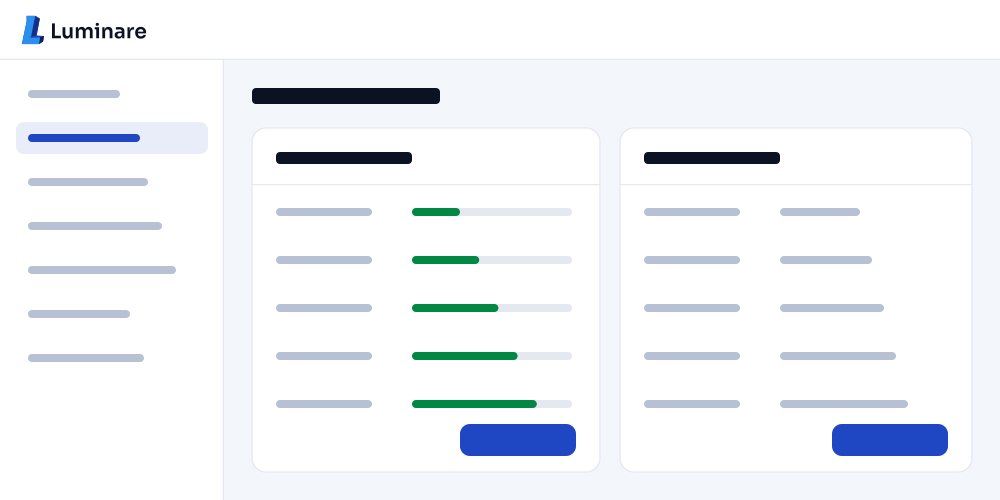
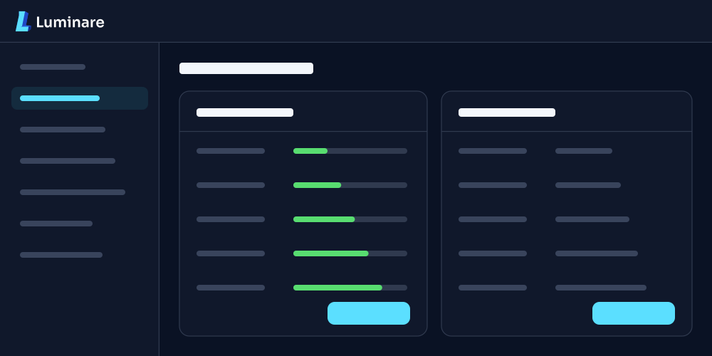
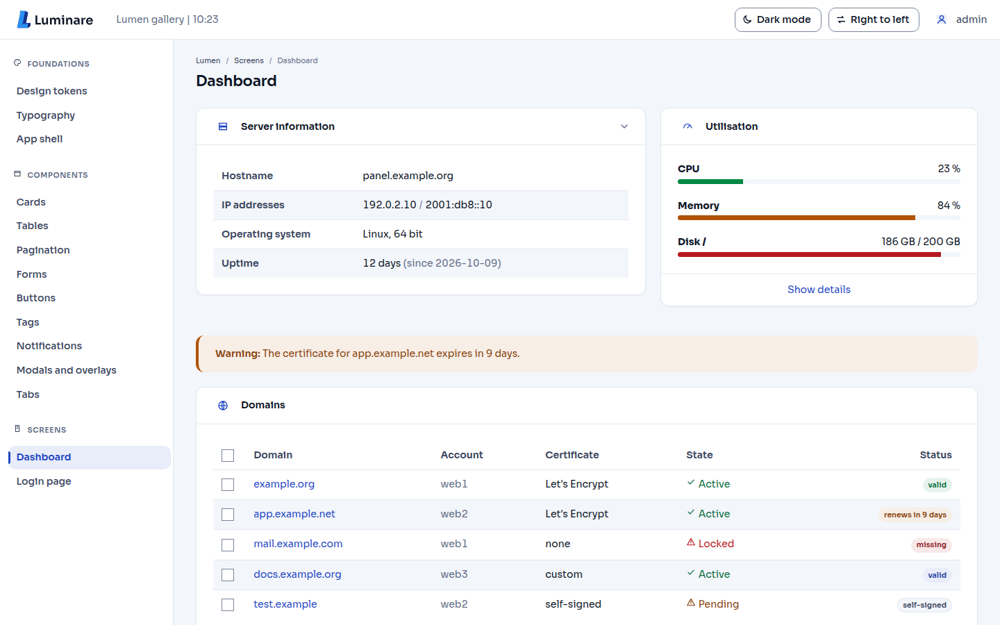
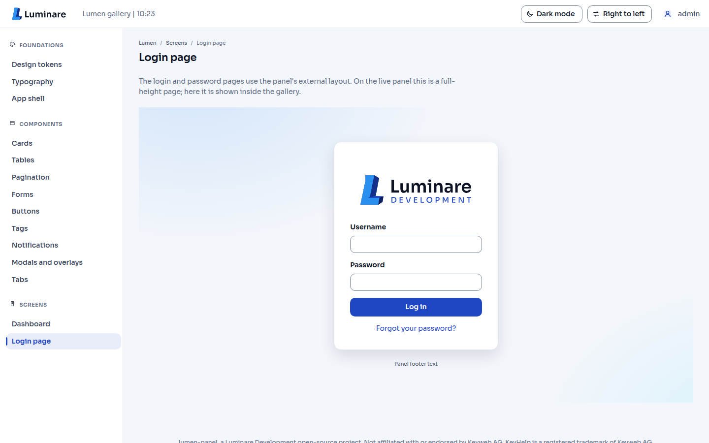
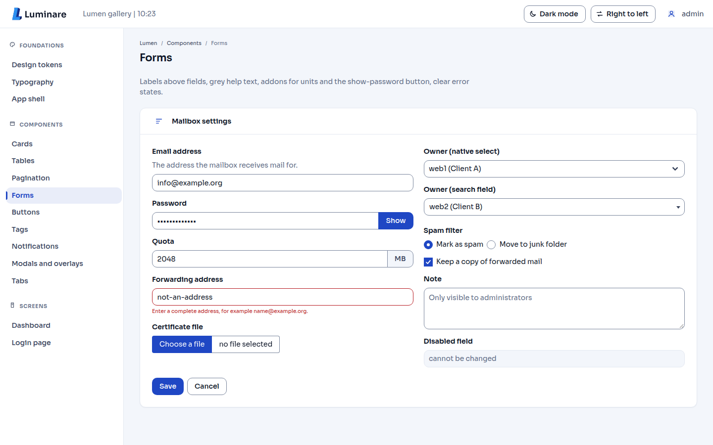
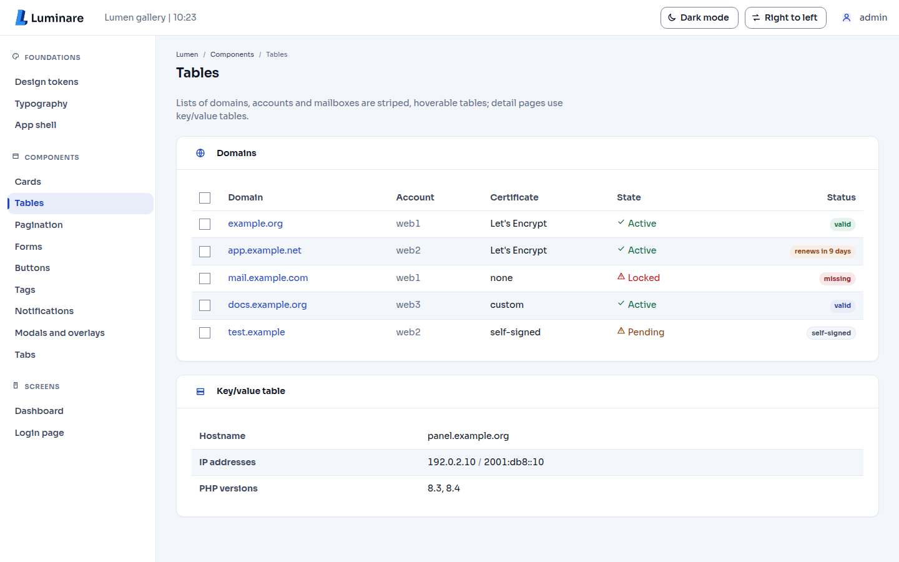
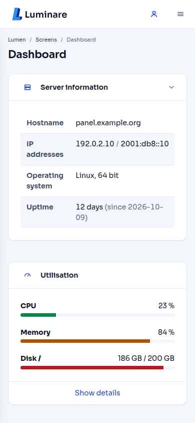
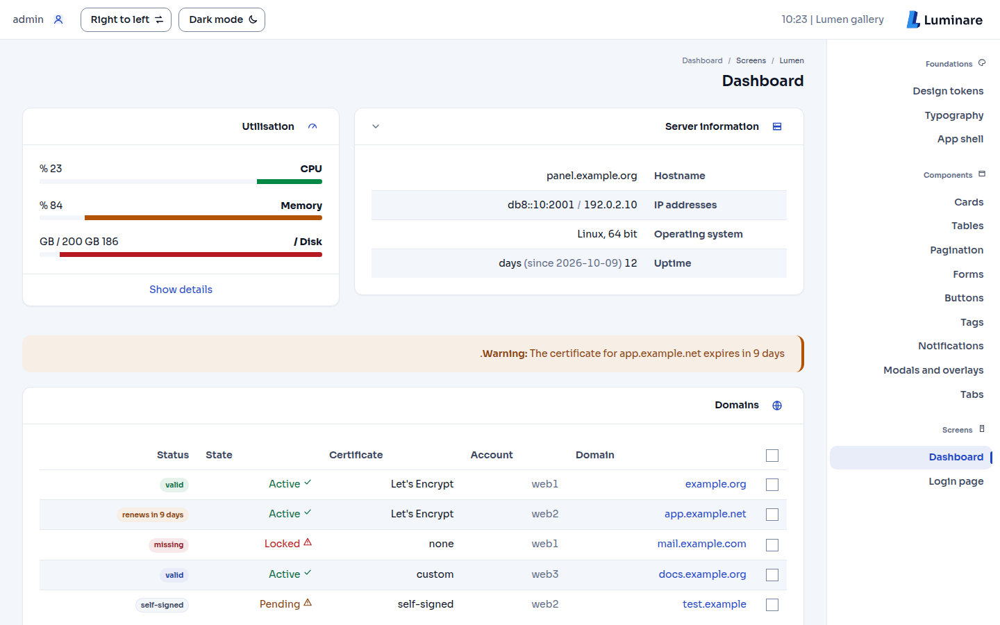
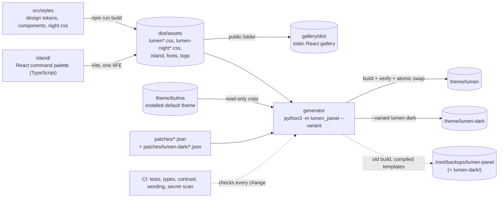

<!-- header:begin: brand-repos 0.1.0, variant studio, files in docs/brand/; the project-page sync drops this block -->
<picture>
  <source media="(prefers-color-scheme: dark)" srcset="docs/brand/readme-header-dark.svg">
  <source media="(prefers-color-scheme: light)" srcset="docs/brand/readme-header-light.svg">
  
</picture>

<!-- byline:studio -->
*a [Luminare Development](https://luminare.tech/open-source/) open-source project*
<!-- /byline:studio -->
<!-- byline:personal
*by Paul Pasaurek · [project page](https://luminare.tech/open-source/lumen-panel/)*
/byline:personal -->
<!-- header:end -->

# lumen-panel

Two modern themes for the KeyHelp hosting panel, **Lumen** (light, and dark where the panel has a
dark mode) and **Lumen Dark** (always dark): a calm, accessible design, a React command palette
(Ctrl+K) and a generator that builds the themes on the server from the panel's own default theme.
Tested with KeyHelp 26.1.1.

[](https://github.com/luminare-dev/lumen-panel/actions/workflows/ci.yml)
[](https://github.com/luminare-dev/lumen-panel/releases)
[](LICENSE)
[](https://scorecard.dev/viewer/?uri=github.com/luminare-dev/lumen-panel)
[](https://www.bestpractices.dev/projects/15777)

## Two themes

| Lumen | Lumen Dark |
|---|---|
|  |  |
| `theme/lumen`, `--variant lumen` (the default) | `theme/lumen-dark`, `--variant lumen-dark` |
| light; follows the panel's own dark mode where the panel has one | always dark, for every account, with or without KeyHelp Pro |

Install either or both, and switch between them under **Configuration** → **Appearance** →
**Theme**. **Lumen Dark is not the dark mode of KeyHelp Pro**: its dark design is lumen-panel's
own stylesheet on top of the panel's standard light stylesheet, and it declares no dark mode. It
does not enable or unlock the panel's dark mode, has no dark-mode switch, and loads none of the
panel's dark stylesheets or images
([ADR 0011](docs/adr/0011-lumen-dark-is-a-design-not-the-pro-dark-mode.md)).

## Screenshots

Rendered from the [gallery](#gallery) with example data only (headless Chrome in the
`screenshots` workflow, 1440 x 900 and 390 x 844 pixels). The live panel uses the same stylesheet.
The previews in the table above are the images the generator draws for the panel's Theme page.

| Dashboard | Login page |
|---|---|
|  |  |

| Forms | Tables |
|---|---|
|  |  |

| Phone width (390 px) | Right to left |
|---|---|
|  |  |

<!-- Screenshot slots for Lumen Dark: docs/screenshots/lumen-dark-dashboard.png,
     lumen-dark-login.png, lumen-dark-forms.png and lumen-dark-tables.png, from the same workflow
     (?mode=night), shown in a table like the ones above once a maintainer has reviewed them. -->
The [gallery](#gallery) renders every page and component in light mode, dark mode and Lumen Dark,
left to right and right to left.

## Why

The panel's default theme follows Bulma 0.9 defaults; two of its grey text helpers (#7a7a7a at
4.29:1 and #b5b5b5 at 2.05:1 on white) fall below the WCAG AA minimum of 4.5:1, and the panel has
no quick way to jump between its many pages. A theme can fix that, but a theme folder is a full copy of the default templates:
those belong to Keyweb AG, cannot be published, and go stale with every panel update.
lumen-panel publishes only its own work (design tokens, stylesheets, a React command palette, a
React design-system gallery) and a generator that patches a local copy of the default templates
in a few anchored places, verifies the result and swaps it in atomically, with a backup and a
one-command rollback.

## Quickstart

Install on the panel server, as root, with a main administrator account for the panel. The full
guide, with the requirements, the checksum step and what changes on disk, is
[docs/install.md](docs/install.md).

```bash
git clone https://github.com/luminare-dev/lumen-panel.git /opt/lumen-panel   # then check out the newest release tag
# put the CI artifact "theme-assets" (digest checked) into /opt/lumen-panel/dist/assets/
cd /opt/lumen-panel/generator
python3 -m lumen_panel install --keyhelp /home/keyhelp/www/keyhelp --dry-run
python3 -m lumen_panel install --keyhelp /home/keyhelp/www/keyhelp
python3 -m lumen_panel verify /home/keyhelp/www/keyhelp/theme/lumen --keyhelp /home/keyhelp/www/keyhelp
```

When verify prints only `ok:` lines, select **Lumen** in the panel under **Configuration** →
**Appearance** → **Theme** and save. To switch back at once, select **Default Theme** there.
Every install saves its undo command as `ROLLBACK.txt` in its backup folder
([rollback and uninstall](docs/install.md#switch-back-roll-back-or-uninstall)).

Lumen Dark is the same three commands with `--variant lumen-dark`; it goes to
`theme/lumen-dark` and is listed as **Lumen Dark**:

```bash
python3 -m lumen_panel install --variant lumen-dark --keyhelp /home/keyhelp/www/keyhelp --dry-run
python3 -m lumen_panel install --variant lumen-dark --keyhelp /home/keyhelp/www/keyhelp
python3 -m lumen_panel verify /home/keyhelp/www/keyhelp/theme/lumen-dark --variant lumen-dark --keyhelp /home/keyhelp/www/keyhelp
```

After a KeyHelp update, read the [KeyHelp changelog](https://changelog.keyhelp.de/) first, then
rebuild when needed, by hand or with the optional units in `contrib/`
([after a KeyHelp update](docs/install.md#after-a-keyhelp-update)):

```bash
python3 -m lumen_panel sync --variant all --keyhelp /home/keyhelp/www/keyhelp   # every installed theme
```

Without a shell, Lumen's stylesheet alone also works through the panel's own White Label
settings, without the command palette and without Lumen Dark
([route B](docs/install.md#route-b-white-label-only), not yet tried on a live panel).

## How it works



### Why no KeyHelp files are in this repository

A KeyHelp theme is a folder with a complete set of Twig templates. The default theme's templates,
stylesheets, scripts and images are Keyweb AG's proprietary files, licensed with each panel; they
may not be published, and a published copy would also be out of date after the next panel
update. So this repository contains none of them, and neither does a release archive or the
`theme-assets` artifact of CI: they hold only lumen-panel's own files. Where a KeyHelp install is
present, a test fails if any file in the repository is a copy of a default theme file. The theme is assembled on the server, from that
panel's own default theme, as a folder of its own below `theme/`, which is how Keyweb describes
own themes ([community forum, Keyweb AG, 2021](https://community.keyhelp.de/viewtopic.php?t=10363)).

### The generator

The generator (`python3 -m lumen_panel`, Python standard library only) assembles a theme on
the server where the panel is installed; `--variant` picks which (`lumen` by default, or
`lumen-dark`):

1. It reads `theme/bulma` of the local installation (never changing it) and copies its templates
   byte for byte into a staging folder; if a panel update changes them meanwhile, it stops.
2. It applies the patch set: Lumen's seven patches in `patches/*.json`, or for Lumen Dark the same
   set with the files of `patches/lumen-dark/` replacing or adding to them (twelve patches). Each
   one inserts a few lines of our own markup next to an anchor that must occur exactly once (load
   the theme's stylesheet, load the palette script on internal pages, show the Luminare logo; for
   Lumen Dark also load the default theme's standard stylesheet whatever the dark-mode setting
   says, declare the dark colour scheme, colour the phone browser's address bar and mark the page
   with `lumen-night`). If an anchor is
   missing or repeated, nothing is written and every failing patch is listed.
3. It adds the theme's own files from `dist/assets/` (each theme only its own stylesheets),
   writes `_settings.json` and a build record (variant, default theme version, the hash of every
   template, the patches, the asset and patch-set hashes), and verifies the result: every
   template must equal the default theme's file, or the default theme's file with the patches
   applied, byte for byte; for Lumen Dark, no template may be able to load a dark stylesheet of
   the default theme.
4. `install` swaps the staging folder in at `theme/lumen` (or `theme/lumen-dark`) with one atomic
   rename; the previous build and its compiled Twig templates move to
   `/root/backups/lumen-panel/<timestamp>/` (Lumen Dark: `/root/backups/lumen-panel/lumen-dark/<timestamp>/`).
   Nothing is deleted. One run per theme at a time (a lock), and a run that is stopped halfway
   leaves nothing the panel would list as a theme; the next run moves its folders to the backups.
   The two themes never share a folder, a lock, a hold or a compiled template
   ([ADR 0012](docs/adr/0012-theme-variants-share-the-build-and-nothing-else.md)).

The patched templates keep loading the default theme's own CSS, JavaScript and images from
`/theme/bulma/`, which KeyHelp updates in place. `check-update` and `sync` compare the build
record with the installed default theme, the built assets and the patch set, and rebuild when
one of them changed.

### What you get

- **Stylesheet.** `--lm-*` design tokens from the Luminare brand palette, Sora for type, an 8px
  spacing grid, 10-14px radii, hairline borders instead of heavy shadows, visible focus rings.
  In Lumen, dark mode follows the panel's own per-user switch; right-to-left pages use the default
  theme's RTL build plus logical properties; reduced motion is respected. Every design-token pair
  in [docs/contrast.md](docs/contrast.md) meets WCAG 2.2 AA in light mode, dark mode and Lumen
  Dark (93 pairs, including the default theme's checkboxes, Select2 options, status text on
  striped and hovered rows, close buttons and footnote marks, which Lumen overrides), with one
  transient exception: in Lumen Dark, an error mark inside a code-editor selection is 3.57:1 while
  it is selected. The table covers the colours Lumen sets, not rules of the default theme it
  leaves alone.
- **Lumen Dark.** The Lumen components with the dark token set (the Night background `#0A1224`,
  `color-scheme: dark` for scrollbars and native controls) on top of the panel's standard light
  stylesheet, plus `src/styles/night.css` for everything that stylesheet still paints light:
  disabled and read-only fields, help and status colours, spinners, file inputs, tables,
  blockquotes, code, menus, scrollbars, autofilled fields, selected text, the code editor
  (CodeMirror, syntax colours that pass 4.5:1) and the rich text editor (Trumbowyg, dark toolbar
  and dialogs around a light editing sheet). The monitoring charts are shown inverted with the hue
  turned back; the panel's images for light backgrounds sit on a small light plate. Live tests
  audit the installed default stylesheet and the editors' stylesheets for light rules Lumen Dark
  does not cover yet.
- **Command palette.** Ctrl+K (Cmd+K on a Mac), or the search button in the header, on every
  page after login (dark in Lumen Dark). It lists the panel's own sidebar and user-menu links, searches them while
  ignoring case and accents, and works fully with the keyboard and a screen reader (modal dialog,
  combobox with a listbox, focus trap, focus returns on close). It renders in shadow roots, so
  its styles and the panel's cannot touch each other, makes no network requests and stores
  nothing ([ADR 0010](docs/adr/0010-the-command-palette-stores-nothing.md)). One deferred script,
  React included, at most 80 KB after gzip (checked by the build; about 72 KB today).
- **Gallery.** A static React app with our own panel-like markup on Bulma 0.9.4: design tokens
  with live contrast numbers, typography, the app shell, cards, tables, pagination, forms,
  buttons, tags, notifications, modals, tabs, the dashboard and the login page, each in light
  mode, dark mode and Lumen Dark, LTR and RTL.

### Gallery

Run it locally (Node.js 22.22.2 or later; no panel needed):

```bash
npm ci --ignore-scripts
npm run dev                         # builds the CSS and the palette, then serves http://localhost:5173/
npm run build && npm run preview    # the static build in gallery/dist/
```

`gallery/dist/` uses relative paths, so it can be served from any folder of any static web
server. The start state can be set in the address, for example `?mode=dark&dir=rtl#forms`
(`mode` is `light`, `dark` or `night` for Lumen Dark). CI keeps every build of it as the
`gallery` artifact for 14 days.

## Design decisions

The decisions behind this project are recorded as short ADRs in [docs/adr/](docs/adr/):

- [ADR 0001: Record architecture decisions](docs/adr/0001-record-architecture-decisions.md)
- [ADR 0002: Pin every action and downloaded tool](docs/adr/0002-pin-actions-and-downloaded-tools.md)
- [ADR 0003: Secret scanning with the gitleaks binary](docs/adr/0003-secret-scanning-with-the-gitleaks-binary.md)
- [ADR 0004: Draft releases with checksums and provenance](docs/adr/0004-draft-releases-with-checksums-and-provenance.md)
- [ADR 0005: Build the theme on the server from the installed default theme](docs/adr/0005-build-the-theme-on-the-server.md)
- [ADR 0006: Small anchored patches that fail loudly](docs/adr/0006-anchored-patches-that-fail-loudly.md)
- [ADR 0007: React for the gallery and one island, not for the panel](docs/adr/0007-react-for-the-gallery-and-one-island.md)
- [ADR 0008: Override by matching selectors, not with cascade layers](docs/adr/0008-override-by-selector-not-by-layer.md)
- [ADR 0009: Atomic swap, backups instead of deletes, narrow cache purge](docs/adr/0009-atomic-swap-backups-and-narrow-cache-purge.md)
- [ADR 0010: The command palette stores nothing, not even a "recent" list](docs/adr/0010-the-command-palette-stores-nothing.md)
- [ADR 0011: Lumen Dark is a design of its own, not the dark mode of KeyHelp Pro](docs/adr/0011-lumen-dark-is-a-design-not-the-pro-dark-mode.md)
- [ADR 0012: Theme variants share the build, and nothing else on disk](docs/adr/0012-theme-variants-share-the-build-and-nothing-else.md)

**Alternatives.** The panel's White Label settings (Configuration → Appearance → White Label)
take logos, a favicon, additional CSS and JavaScript; that is the right tool for a logo and a few
colours, the lighter [route B](docs/install.md#route-b-white-label-only) uses it for Lumen's
stylesheet alone, and both themes keep White Label CSS and logos working on top. A hand-maintained
copy of the default theme gives full control over the markup, but it cannot be shared and drifts
with every panel update.

## Supported versions

| Component | Tested with | Supported |
|---|---|---|
| KeyHelp (default theme `bulma`) | 26.1.1 on Ubuntu 24.04: Lumen built, verified, installed and selected on the live panel; Lumen Dark built and verified against it (read-only), not yet installed there | 26.1.x; other versions when every patch anchor still fits (the dry run and every build check it) |
| Operating system | Ubuntu 24.04 | the systems KeyHelp runs on (Keyweb lists Ubuntu LTS and Debian) |
| Python (generator) | 3.12 | 3.10 or later |
| Node.js (only to build the assets) | 22.x in CI (GitHub's ubuntu-24.04 runner) | 22.22.2 or later (22.x), 24.15 or later, 26 |
| Browsers | not yet tested in a browser | written for Chrome/Edge 111+, Firefox 121+, Safari 16.4+ |

How compatibility is checked:

- **Every build**, the dry run included, needs each patch anchor exactly once in the installed
  default templates; otherwise nothing is written and every failing patch is listed.
- **Every build is verified** byte for byte against the installed default theme (each template is
  equal, or equal with the patches applied), and the patched templates pass a Twig syntax check.
- **`check-update`** compares the default theme's version and a hash over all its templates with
  the build record, so a KeyHelp update, or a KeyHelp patch that only changes templates, is
  noticed (exit 10).
- **The tests** check every anchor of both themes against the local KeyHelp install when one is
  present, build Lumen Dark from it into a temporary folder, and audit its standard stylesheet for
  light rules Lumen Dark does not cover; CI builds and verifies both themes on every commit
  against a fake panel tree of our own.
- **Before a KeyHelp update**, read the [KeyHelp changelog](https://changelog.keyhelp.de/) for
  changes to the template system, themes or White Label
  ([after a KeyHelp update](docs/install.md#after-a-keyhelp-update)).

Fixes go into the latest minor release only. See the
[security policy](https://github.com/luminare-dev/.github/blob/main/SECURITY.md) for reporting.

## Limitations

- Only the default theme's markup is restyled; pages a panel update adds look right only as far
  as they use the same Bulma components.
- After a panel update, `sync` must run (manually or from the units) before the copied templates
  match the panel again; until then, the previous build stays active. When a patch no longer fits,
  that previous build keeps running against the new panel until the patch set is fixed
  ([runbook](docs/runbook.md#failure-lumen-panel-syncservice-failed)).
- The Luminare logo replaces the KeyHelp logo on every panel page, also for client accounts.
- Releases carry the source archive only. The built assets come from the CI artifact
  `theme-assets`, which GitHub keeps for 30 days, or from a build with Node.js on another machine.
- With the White Label route alone there is no command palette, no Sora font and only part of the
  login page design ([route B](docs/install.md#route-b-white-label-only)).
- The command palette knows only the links of the sidebar and the user menu, not the actions
  inside pages, and it has no "recent pages" list.
- Sora covers Latin only: in the Russian, Arabic and Chinese panels the whole page uses the
  system font instead.
- In Lumen, Chart.js charts and the code and text editors (CodeMirror, Trumbowyg) keep the default
  theme's colours ([docs/keyhelp-markup.md](docs/keyhelp-markup.md)).
- In Lumen Dark, what no stylesheet can reach stays as the panel draws it for light pages: the
  doughnut charts (no text, an HTML legend next to them; their white segment borders show as white
  rings on the dark card), the embedded Rspamd interface, and the panel's images for light
  backgrounds and the app catalogue's logos, which sit on a small light plate. The monitoring
  charts are shown inverted: their labels pass 4.5:1, but the light series (orange, yellow, grey)
  come out darker, about as faint on the card as they are on white in the default theme, and
  tooltips appear light.
- In Lumen Dark, the rich text editor's editing area (e-mail to all users, the configuration
  message) is a light sheet, because the editor's colour menu applies inline colours chosen for
  white, and the messages are read on white. White Label logos are shown as uploaded: a logo made
  for light backgrounds sits on the dark header and login box.
- Lumen Dark has no light mode of its own; a light panel is Lumen (or the default theme), selected
  by an administrator for all accounts. Route B (White Label only) covers Lumen, not Lumen Dark.

## Results

| What | Value | How it was measured |
|---|---|---|
| Contrast, text pairs | 70 pairs (52 in every mode, 18 only in Lumen Dark: selected text, editor syntax and selections, the rich text editor's sheet and dialogs, chart labels), lowest 4.55:1 (light), 4.51:1 (dark and Lumen Dark), minimum 4.5:1; plus one transient pair at 3:1 (an error mark inside a code selection, 3.57:1) | `python3 scripts/contrast.py`, WCAG 2.x formula, 2026-10-21; full table in [docs/contrast.md](docs/contrast.md) |
| Contrast, UI parts | 22 pairs (control borders, focus rings, progress fills, close-button crosses, the editor cursor, the active toolbar button, inline-coloured icons), lowest 3.17:1 (light) and 3.08:1 (dark and Lumen Dark), minimum 3:1 | same |
| Generator and repository tests | 226 Python tests pass, 1 skipped (a template-only test), with gitleaks and markdownlint-cli2 on the path | `LUMEN_BRAND_KIT=<kit> python3 -m unittest discover -s tests`, 2026-10-21, with the KeyHelp 26.1.1 install present (read-only), including the audits of its default and editor stylesheets |
| Generator against the live panel | Lumen: build and verify pass (215 templates, 211 byte for byte equal to the default theme, 4 patched files reproduce exactly), installed and selected. Lumen Dark: build and verify pass (12 patches, the Pro boundary check included), its patched templates load only `style.css` and `style-rtl.css` of the default theme; installed next to Lumen on 2026-10-21 from the CI assets. Lumen's patched templates, settings and readme came out byte for byte as before Lumen Dark (apart from the asset hash), and its patch-set hash is the installed build's: `check-update` reports the installed Lumen up to date with the assets it was installed from | `python3 -m lumen_panel build --variant <theme>` and `verify --keyhelp` into a scratch folder with placeholder assets (read-only), then `install --variant lumen-dark` on the panel, KeyHelp 26.1.1, 2026-10-21 |
| Command palette tests | 52 tests pass (Vitest, fast-check property tests, jsdom, Testing Library) | `npm test` in CI (Node.js 22), 2026-10-21 |
| Command palette size | 71.8 KB after gzip (CI, 2026-10-21); the build fails above 80 KB | `node scripts/check-island.mjs` |
| Stylesheet size | about 46 KB per file, minified (Lumen's four files); about 65 KB for each of Lumen Dark's two files | `node scripts/build-css.mjs` in CI, 2026-10-21 |

## Documentation and links

- [Installation](docs/install.md) (the themes, or the White Label route) ·
  [Keeping it current after KeyHelp updates](docs/update.md) ·
  [Configuration](docs/configuration.md) · [Upgrading lumen-panel](docs/upgrade.md) ·
  [Troubleshooting](docs/troubleshooting.md) · [Runbook](docs/runbook.md) · [ADRs](docs/adr/) ·
  [Panel markup inventory](docs/keyhelp-markup.md) · [Contrast table](docs/contrast.md) ·
  [Official KeyHelp resources](docs/keyhelp-resources.md)
- [Changelog](CHANGELOG.md) (written by release-please) and
  [releases](https://github.com/luminare-dev/lumen-panel/releases) (each release has
  `SHA256SUMS` and, while the repository is public, signed SLSA build provenance as
  `<archive>.intoto.jsonl`; [how to verify a release](docs/install.md#verify-a-release))
- [Contributing](https://github.com/luminare-dev/.github/blob/main/CONTRIBUTING.md) ·
  [Code of conduct](https://github.com/luminare-dev/.github/blob/main/CODE_OF_CONDUCT.md) ·
  [Security](https://github.com/luminare-dev/.github/blob/main/SECURITY.md) ·
  [Support](https://github.com/luminare-dev/.github/blob/main/SUPPORT.md)
- Project page: <https://luminare.tech/open-source/lumen-panel/>
- OpenSSF Best Practices: <https://www.bestpractices.dev/projects/15777> (passing)

## Official KeyHelp resources

KeyHelp is developed by Keyweb AG; for the panel itself, these official pages are the reference
(each checked on 2026-10-21; what each one says is recorded in
[docs/keyhelp-resources.md](docs/keyhelp-resources.md)):

- [KeyHelp product page](https://www.keyweb.de/en/keyhelp/keyhelp/) (`www.keyhelp.de` redirects
  there)
- [Overview of all functions](https://www.keyweb.de/en/keyhelp/keyhelp/overview-of-all-functions):
  "With the white-label function, you can tailor the server hosting tool to your design ideas:
  Use your own logo and adapt styles and functions to your own wishes and needs. In addition, you
  can also develop your own themes."
- [Install KeyHelp](https://www.keyweb.de/en/keyhelp/keyhelp/#install): requirements and the
  installer of the panel itself
- [Knowledge base](https://kb.keyhelp.de/) with the user and administrator manual
  ([English](https://kb.keyhelp.de/index.php?ln=en))
- [Tutorials](https://www.keyweb.de/en/support/learn-more/tutorials#keyhelp), among them
  "Install KeyHelp" and "Customize with white label"
- [Changelog](https://changelog.keyhelp.de/): read it before every KeyHelp update
- [Community forum](https://community.keyhelp.de/), "The official KeyHelp forum of Keyweb AG",
  for example Keyweb's notes on [own themes and the KeyHelp logo](https://community.keyhelp.de/viewtopic.php?t=10363)
- [REST API documentation](https://api.keyhelp.de) (opens on SwaggerHub; lumen-panel does not use
  the API)

## Not affiliated

KeyHelp is a registered trademark of Keyweb AG. lumen-panel is not affiliated with or endorsed by
Keyweb AG. "KeyHelp" is named only to describe what this project works with. This repository
contains no KeyHelp file. lumen-panel never uses or changes the KeyHelp logo files, and its
documentation does not link them: the themes show their own logo in their place, or your White
Label logo. The themes are built from the KeyHelp installation on the server where they run
([why](#why-no-keyhelp-files-are-in-this-repository)). Lumen Dark adds nothing that loads, sets or
reads the panel's dark mode. Its patches never use the switch, the dark stylesheets or the `dark/`
images, and the panel's own unchanged templates pick `dark/` images only when the panel itself
reports dark mode, which it does not offer without KeyHelp Pro or for a theme that declares none
([ADR 0011](docs/adr/0011-lumen-dark-is-a-design-not-the-pro-dark-mode.md)).

## Licence

[MIT](LICENSE). The licence covers the code only: the project name, logo, header images,
`docs/brand/` and `assets/brand/` are not licensed (see [NOTICE](NOTICE)). The Sora font keeps its
own licence ([THIRD_PARTY_NOTICES.md](THIRD_PARTY_NOTICES.md)).

<!-- byline:studio -->
*a [Luminare Development](https://luminare.tech/open-source/) open-source project*
<!-- /byline:studio -->
<!-- byline:personal
*by Paul Pasaurek · [project page](https://luminare.tech/open-source/lumen-panel/)*
/byline:personal -->
